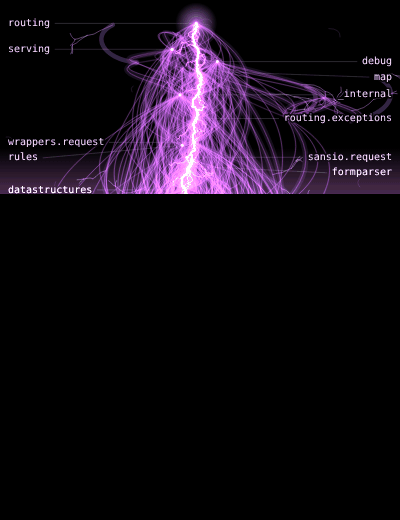

# Grafo neon

[](https://github.com/Netero-mac/Grafo-neon/actions/workflows/testes.yml)

[Português](README.md) · **English**

Paste a link to any public GitHub repository and see the dependencies between its files drawn as neon lightning.

**Site:** https://netero-mac.github.io/Grafo-neon/ (the interface is in Portuguese; the buttons are explained below)



Each strand is an import between two files of the project: the importer sits above, the imported file below. The white lightning bolt in the middle is the project's **longest import chain**. Tap a label to light up everything that file pulls in and see what it imports and who imports it.

## How to use

### On the site

Paste any of these formats and press **Desenhar** (Draw):

| Format | Example |
|---|---|
| owner/repository | `pallets/flask` |
| repository link | `https://github.com/psf/requests` |
| link to a branch or folder | `https://github.com/pytest-dev/pytest/tree/main/src` |

After drawing, the page address becomes a shareable link, for example `…/Grafo-neon/?repo=pallets/flask`.

Tests are left out by default. Uncheck **Ignorar testes** (Ignore tests) to include them.

### Colors and images

Below the drawing you can pick a palette (**Neon**, **Ouro** = gold, **Gelo** = ice, **Brasa** = ember) and download a PNG with **Baixar imagem**:

| Format | Size |
|---|---|
| Como está na tela (as on screen) | the drawing's size, at your screen's pixel density |
| Papel de parede (wallpaper) | 1080 × 2340, with room for the clock and app icons |
| Post | 1080 × 1350, with the project name and numbers at the bottom |
| Prévia do GitHub (GitHub preview) | 1280 × 640: upload it in the repository's **Settings → Social preview**, and links to the project will show the graph when shared |

The chosen color is saved in the browser and travels with the link (`&cor=ouro`).

### In the terminal (local folders and private projects)

```bash
python3 grafo_neon.py path/to/project
python3 grafo_neon.py path/to/project -o my_graph.html --titulo "My App"
python3 grafo_neon.py path/to/project --sem-testes --max-nos 300 --json
```

The script uses only the Python standard library (3.10+) and writes a single HTML page that works offline. It needs `render.js`, `grafo.js` and `estilo.css` in the same folder, so download the whole repository.

## Languages

| Language | What counts as a dependency |
|---|---|
| Python | `import` and `from … import`, including relative ones (`from . import x`). The script parses with `ast`; the site uses regular expressions, and both match the test answer key. |
| PHP / Laravel | `use App\…`, fully qualified names (`\App\Models\User`) and classes from the same namespace used by short name |
| Kotlin / Java | `import`, fully qualified names in code, and top-level classes, functions and `val`s from the same package (common in Jetpack Compose) |
| JavaScript / TypeScript | `import … from './x'`, `export … from`, `require()` and `import()` with a relative path or `@/` |
| Dart / Flutter | `import`, `export` and `part`, including `package:name/…` resolved through `pubspec.yaml` |
| Go | an `import` of a package from the same module (via `go.mod`) links to every file of that package except tests. Names declared in another file of the same package also count |
| C / C++ | `#include "…"` relative to the file, or by path suffix. `#include <dir/x.h>` only when it has a folder, so it isn't confused with system headers |
| C# | types from namespaces brought in by `using` and `global using`, from the file's own namespace and its parents, and fully qualified names |
| Rust | `use crate::`, `super::`, `self::` and `crate_name::` (with braces), `mod x;` and paths to child modules |

For projects with more than 2,000 imports, strands are drawn in batches and the edge decorations are capped. That way, even Go's standard library (about 19 thousand links) redraws in under a tenth of a second.

Only links **between files of the project itself** are included. External libraries are left out, and so are files with no links at all.

## Circular imports

When a group of files imports each other in a circle (A imports B, which imports C, which imports A), that group's strands turn **red**. The panel lists each group with an example cycle, and the **Destacar ciclos** (Highlight cycles) button dims the rest of the drawing.

Only imports that run at load time count. Left out are:

- in Python, imports inside functions and inside `if TYPE_CHECKING:`;
- in JS/TS, `import type` and dynamic `import()`.

Implicit references, which link files without being real imports, don't count either:

- names used within the same package (Go, Kotlin/Java) or namespace (C#, PHP);
- Rust `mod x;` declarations, which only build the module tree.

These links are drawn fainter. In Python and JS, a cycle can break imports depending on load order. In Kotlin, Java and PHP it causes no error, but it signals tight coupling.

## X-ray

The **Raio-X** (X-ray) panel shows:

- **Mais críticos** (most critical): the files that the most other files depend on, directly or indirectly. These are the ones most likely to break the project when they change.
- **Mais dependentes** (most dependent): the files that pull in the most.
- **Summary:** the longest chain, the average number of imports per file, and how many files were left out of the drawing for having no links. Tap the summary to see the list of those files.

Each file's card shows the same numbers: how many files it imports and how many import it, directly and in total.

## How it works

1. **File list:** the site asks the GitHub API for the repository tree (2 requests). If the rate limit is hit, it falls back to the [jsDelivr](https://www.jsdelivr.com/) mirror.
2. **Contents:** it downloads the code files from `raw.githubusercontent.com`, 10 at a time, switching to jsDelivr if GitHub refuses.
3. **Analysis** (`analisador.js`): finds each file's imports and turns them into edges `a → b` ("a imports b").
4. **Cycles and X-ray** (`grafo.js`): strongly connected components (Tarjan), with a short example cycle per group found by breadth-first search, plus each file's forward and backward reach.
5. **Drawing** (`render.js`):
   - breaks cycles with a depth-first search;
   - arranges files in layers;
   - finds the longest chain and draws it as lightning, using midpoint displacement;
   - places the remaining files near their neighbors (neighbor averaging);
   - draws each import as a Bézier curve in several glow passes on a Canvas.

Everything runs in the browser. There is no server, and nothing is sent anywhere except the requests to GitHub and jsDelivr.

## Limits

- Without signing in, the GitHub API allows **60 requests per hour** per IP address, and each repository uses 2.
- The site reads up to 1,500 code files and draws up to 600. For huge repositories, point to a folder (`…/tree/main/src`).
- Imports built at runtime (`importlib`, `require(variable)`, Laravel routes written as strings) don't show up.
- In Go, Kotlin/Java, C# and PHP, names from the same package or namespace are matched as text, so there may be a few extra links. These links are light and don't count toward cycles.

## Tests

```bash
node --test testes/analisador.test.js        # the site's analyzer and graph algorithms
python -m unittest discover -s testes -v     # the script, the generated page and parity with the site
```

The projects in `testes/fixtures` (one per language) cover the tricky cases:

- imports inside functions and inside `if TYPE_CHECKING:`;
- function signatures spanning several lines;
- subpackages without `__init__.py`;
- a project `json.py` with the same name as the standard library module;
- imports mentioned inside docstrings and strings;
- `import type`, `import()` and `require`;
- Dart `package:`, Go's `go.mod` and test files, include by folder in C, `global using` in C#, and `use` with braces and `super::` in Rust.

`testes/esperado.json` holds the correct imports and cycles for each project, written by hand. Both analyzers are checked against that answer key and against each other. GitHub Actions runs everything on every push, with Python 3.10 and 3.13.

## Structure

```
index.html      the site's page
app.js          fetches the repository from GitHub and shows progress
analisador.js   finds imports (Python, JS/TS, PHP, Kotlin/Java, Dart, Go, C/C++, C#, Rust)
grafo.js        graph algorithms with no UI (cycles, X-ray), shared with the script
render.js       neon Canvas drawing, shared with the script
estilo.css      styles, shared with the script
exemplo.json    example graph shown on first load (pytest's core)
grafo_neon.py   command-line version for local folders
testes/         tests, sample projects and answer key
```

To run the site locally: `python3 -m http.server` in the project folder, then open `http://localhost:8000`.
