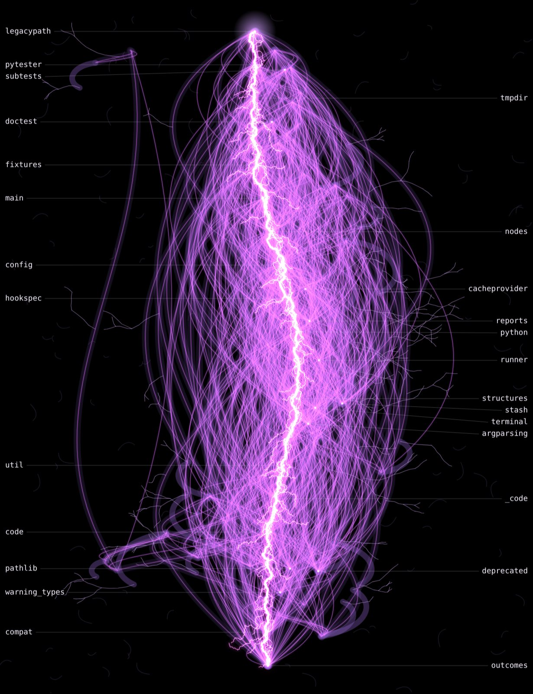

# Grafo neon

Cole o link de um repositório público do GitHub e veja as dependências entre os arquivos desenhadas como um raio neon.

**Site:** https://netero-mac.github.io/Grafo-neon/



Cada fio é um import entre dois arquivos do projeto: quem importa fica em cima, o que é importado fica embaixo. O raio branco no meio é a **maior cadeia de imports** do projeto. Toque num rótulo para acender tudo o que aquele arquivo puxa e ver a lista do que ele importa e de quem o importa.

## Como usar

### No site

Cole qualquer um destes formatos e toque em **Desenhar**:

| Formato | Exemplo |
|---|---|
| dono/repositório | `pallets/flask` |
| link do repositório | `https://github.com/psf/requests` |
| link de um ramo ou pasta | `https://github.com/pytest-dev/pytest/tree/main/src` |

Depois de desenhar, o endereço da página vira um link que você pode compartilhar, por exemplo `…/Grafo-neon/?repo=pallets/flask`.

Os testes ficam de fora por padrão. Desmarque **Ignorar testes** para incluí-los.

### Cores e imagens

Abaixo do desenho dá para escolher a paleta (**Neon**, **Ouro**, **Gelo** ou **Brasa**) e baixar um PNG:

| Formato | Tamanho |
|---|---|
| Como está na tela | o tamanho do desenho, com a densidade da sua tela |
| Papel de parede | 1080 × 2340, com espaço para o relógio e os ícones |
| Post | 1080 × 1350, com o nome do projeto e os números embaixo |
| Prévia do GitHub | 1280 × 640: suba em **Settings → Social preview** do repositório, e o link do projeto passa a mostrar o grafo quando for compartilhado |

A cor escolhida fica salva no navegador e vai junto no link (`&cor=ouro`).

### No terminal (pastas locais e projetos privados)

```bash
python3 grafo_neon.py caminho/do/projeto
python3 grafo_neon.py caminho/do/projeto -o meu_grafo.html --titulo "Meu App"
python3 grafo_neon.py caminho/do/projeto --sem-testes --max-nos 300 --json
```

O script só usa a biblioteca padrão do Python (3.8+) e gera uma página HTML única que funciona offline. Ele precisa de `render.js` e `estilo.css` na mesma pasta, então baixe o repositório inteiro.

## Linguagens

| Linguagem | O que conta como dependência |
|---|---|
| Python | `import` e `from … import`, inclusive relativos (`from . import x`). O script lê com `ast`; o site lê com expressões regulares e chegou ao mesmo resultado nos testes. |
| PHP / Laravel | `use App\…`, nomes completos (`\App\Models\User`) e classes do mesmo namespace usadas pelo nome curto |
| Kotlin / Java | `import`, nomes completos no código e classes, funções e `val` de nível superior do mesmo pacote (comum no Jetpack Compose) |
| JavaScript / TypeScript | `import … from './x'`, `export … from`, `require()` e `import()` com caminho relativo ou `@/` |

Só entram ligações **entre arquivos do próprio projeto**. Bibliotecas externas ficam de fora, e arquivos sem nenhuma ligação também.

## Imports circulares

Quando um grupo de arquivos se importa em círculo (A importa B, que importa C, que importa A), os fios desse grupo ficam **vermelhos**. O painel lista cada grupo com um ciclo de exemplo, e o botão **Destacar ciclos** apaga o resto do desenho.

Só contam os imports que rodam no carregamento. Ficam de fora:

- em Python, imports dentro de funções e dentro de `if TYPE_CHECKING:`;
- em JS/TS, `import type` e `import()` dinâmico.

Esses imports aparecem mais apagados no desenho. Em Python e JS, um ciclo pode quebrar a importação conforme a ordem em que os arquivos carregam. Em Kotlin, Java e PHP ele não dá erro, mas indica acoplamento forte.

## Como funciona

1. **Lista de arquivos:** o site pede a árvore do repositório à API do GitHub (2 consultas). Se o limite estourar, ele usa o espelho do [jsDelivr](https://www.jsdelivr.com/).
2. **Conteúdo:** baixa os arquivos de código do `raw.githubusercontent.com`, 10 de cada vez, e passa para o jsDelivr se o GitHub recusar.
3. **Análise** (`analisador.js`): acha os imports de cada arquivo e os transforma em arestas `a → b` ("a importa b").
4. **Ciclos** (`grafo.js`): componentes fortemente conexos (Tarjan) e um ciclo curto de exemplo para cada grupo, achado com busca em largura.
5. **Desenho** (`render.js`):
   - quebra os ciclos com uma busca em profundidade;
   - organiza os arquivos em camadas;
   - acha a maior cadeia e a desenha como um raio, com deslocamento de ponto médio;
   - posiciona o resto aproximando cada arquivo dos vizinhos (média dos vizinhos);
   - desenha cada import como uma curva de Bézier em várias passadas de brilho, num Canvas.

Tudo roda no navegador. Não existe servidor, e nada é enviado para lugar nenhum além dos pedidos ao GitHub e ao jsDelivr.

## Limites

- Sem login, a API do GitHub permite **60 consultas por hora** por endereço IP, e cada repositório gasta 2.
- O site lê até 1.500 arquivos de código e desenha até 600. Em repositórios enormes, aponte para uma pasta (`…/tree/main/src`).
- Imports montados em tempo de execução (`importlib`, `require(variavel)`, rotas do Laravel em texto) não aparecem.
- Em Kotlin e PHP, nomes curtos do mesmo pacote ou namespace são reconhecidos por texto, então pode haver alguma ligação a mais.

## Estrutura

```
index.html      página do site
app.js          busca o repositório no GitHub e mostra o progresso
analisador.js   acha os imports (Python, PHP, Kotlin/Java, JS/TS)
grafo.js        algoritmos de grafo sem tela (ciclos), compartilhado com o script
render.js       desenho neon em Canvas, compartilhado com o script
estilo.css      estilos, compartilhados com o script
exemplo.json    grafo de exemplo mostrado na abertura (núcleo do pytest)
grafo_neon.py   versão de linha de comando para pastas locais
```

Para rodar o site no seu computador: `python3 -m http.server` na pasta do projeto, depois abra `http://localhost:8000`.
